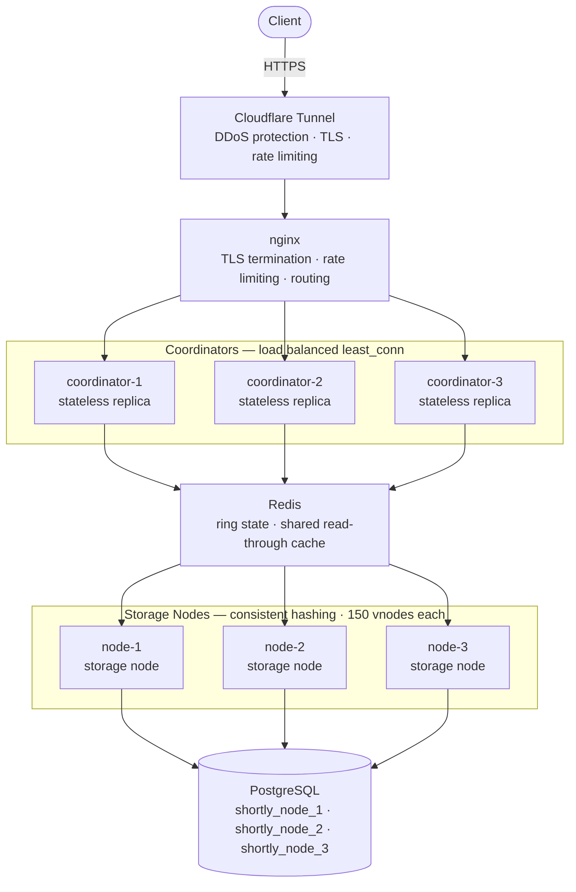

# Shortly: A Distributed URL Shortener

## Overview

Shortly is a horizontally scaled URL shortening service built to demonstrate the core mechanics of distributed systems design: consistent hashing, replicated stateless coordination, shared caching, and independent storage nodes. Rather than a single Flask process backed by SQLite, Shortly is composed of multiple cooperating services, each with a distinct responsibility, orchestrated through Docker Compose and fronted by an nginx gateway.

The project was built to explore, in a hands on way, how a link shortening service could be designed to scale horizontally: distributing writes across multiple storage nodes using consistent hashing, avoiding a single point of failure at the coordination layer through replication, and using a shared cache to absorb read traffic before it reaches storage.

Production deployment has not been performed as part of this repository work. `https://thiyaga.dev` is the intended public origin, but publishing the stack, changing DNS/Tunnel configuration, or creating cloud resources requires an explicit deployment decision and authorization.

---

## Problem Statement

A URL shortener is a deceptively simple idea that exposes many real distributed systems problems once it needs to scale beyond a single process and a single database file:

- How do you distribute stored links across multiple storage backends without a central bottleneck deciding where every link lives.
- How do you keep the request coordinating layer itself from becoming a single point of failure.
- How do you avoid every read hitting a database round trip when a large fraction of links are requested repeatedly.
- How do you add or remove a storage node without reshuffling the entire dataset.

Shortly is structured specifically to answer these questions with a working implementation rather than a theoretical description.

---

## Architecture

### High level topology



### Component responsibilities

**nginx (public gateway)**
Terminates TLS, applies per route rate limiting, blocks administrative endpoints from public access, and load balances across the three coordinator replicas using a least connections strategy. It also serves the built React frontend directly and routes API and redirect traffic to the coordinators.

**Coordinator (3 replicas)**
The coordinator is a stateless Flask service. Its only job is to determine which storage node owns a given key, using a consistent hash ring, and forward the request to that node. Because the coordinator holds no local state beyond an in memory ring cache that is refreshed from Redis, any of the three replicas can serve any request, and losing one replica does not lose any data or in flight ring state.

**Consistent hash ring**
The ring assigns each storage node a number of virtual nodes (150 by default), positioned on a hash space using SHA-256. Distributing physical nodes across many virtual positions keeps load evenly spread even when a node is added or removed, and only the affected fraction of keys need to move, rather than the entire keyspace. Ring state itself is persisted in Redis so all coordinator replicas observe the same ring without needing direct coordination between themselves.

**Redis (shared cache and ring state)**
Redis serves two distinct purposes in this system. First, it is the source of truth for the current ring membership, allowing any coordinator replica to reconstruct the same ring on startup or after a change. Second, it functions as a read through cache for resolved short links, so that repeated requests for the same short URL are served without a round trip to the owning storage node or its database. Redis requires AUTH, is reachable only on the internal Docker network, and uses `volatile-lru` so memory pressure can evict expiring URL-cache entries without evicting the non-expiring ring state.

**Storage nodes (3 active by default, optional fourth scale profile)**
Each storage node is an independent Flask service responsible for a partition of the total keyspace, as determined by the consistent hash ring. Each node owns its own logical Postgres database, meaning storage nodes do not share tables and cannot conflict with one another. Nodes expose authenticated migration endpoints used by the coordinator when ring membership changes. `node-4` is kept behind the Compose `scale` profile so add/remove-node behavior can be exercised locally without changing the default three-node topology.

**Postgres**
A single Postgres instance hosts one logical database per storage node. The default topology uses `shortly_node_1` through `shortly_node_3`; the idempotent bootstrap also prepares `shortly_node_4` for the optional scale-profile exercise. This keeps node data logically isolated while sharing one Postgres server for local/project-scale operation.

**Frontend**
A React and TypeScript single page application, built with Vite and styled with Tailwind CSS, presents the live state of the ring, cache statistics, and a form to create shortened URLs. The frontend polls a read only statistics endpoint on the coordinator every five seconds and renders the current distribution of virtual nodes across storage nodes, along with live cache hit and miss counts.

---

## Request Flow

### Creating a short URL

1. The client submits a request to `/shorten` with the original URL and an optional expiry.
2. nginx applies rate limiting and forwards the request to one of the three coordinator replicas.
3. The coordinator normalizes the destination URL, generates a random seven-character short ID, and hashes **that ID** against the consistent hash ring to select a storage node.
4. The coordinator sends both the short ID and normalized URL to the selected node.
5. The storage node inserts the mapping in its own PostgreSQL database, atomically rejects an ID collision, and returns the stored ID, URL, and expiry. The coordinator retries a collision once with a fresh ID.
6. The coordinator populates the shared Redis cache with the normalized destination and returns a short URL using the configured HTTPS `PUBLIC_BASE_URL`.

### Resolving a short URL

1. The client requests `/<short_id>`.
2. The coordinator first checks the shared Redis cache. If the mapping is present, it issues a redirect immediately without contacting any storage node.
3. On a cache miss, the coordinator consults the consistent hash ring to determine the owning storage node, forwards the resolution request, and caches the result for subsequent requests before redirecting the client.

### Ring membership changes

On a membership change the coordinator briefly pauses new shortens, exports the previous owners' records once, and routes only changed keys by their IDs into the new owners. It verifies copied records **before** atomically publishing the new ring and only then prunes old copies. Removal of an unavailable node requires explicitly acknowledging the possible data loss with `force=true`.

---

## Technology Stack

**Backend**
Python, Flask, Gunicorn

**Storage**
PostgreSQL, one logical database per storage node

**Caching and coordination state**
Redis, used both as a shared cache and as the persistence layer for consistent hash ring membership

**Frontend**
React, TypeScript, Vite, Tailwind CSS

**Gateway and load balancing**
nginx, with TLS termination, per route rate limiting, and least connections load balancing across coordinator replicas

**Containerization and orchestration**
Docker, Docker Compose

**Public access**
Cloudflare Tunnel, providing outbound only connectivity from the host machine to a public domain without requiring inbound firewall rules

---

## API Reference

### Create a short URL

`POST /shorten`

Request body:
```json
{
  "org_url": "https://www.example.com",
  "expiry_days": 7
}
```

Response:
```json
{
  "short_url": "https://thiyaga.dev/abc123",
  "org_url": "https://www.example.com",
  "expires_at": "2026-07-14T00:00:00"
}
```

### Resolve a short URL

`GET /<short_id>`

Returns an HTTP 302 redirect to the original URL if the mapping exists and has not expired. Returns HTTP 404 if the identifier does not exist, and HTTP 410 if it has expired.

### Link metadata

`GET /api/info/<short_id>`

Returns a link's ID, normalized destination, creation and expiry timestamps, and last-access time. The legacy `click_count` column is intentionally **not** returned as an accurate click metric: cache hits bypass PostgreSQL, so that database count only reflects uncached resolutions. A future analytics feature would need a deliberate distributed counting design.

### Live statistics

`GET /api/stats`

Returns a read only snapshot of current ring composition, per node virtual node distribution, load balance standard deviation, and cache hit, miss, and eviction counts. This endpoint powers the live frontend dashboard and requires no authentication, as it exposes only aggregate operational state.

### Health check

`GET /health`

Returns the health status of the coordinator, including Redis connectivity and the number of currently registered storage nodes. Used for container health checks and uptime monitoring.

### Administrative endpoints

Endpoints under `/admin` manage ring membership directly, including adding, listing, and removing storage nodes, and inspecting or clearing cache state. These endpoints require an API key and are blocked at the nginx layer from public access, remaining reachable only from within the internal Docker network.

---

## Design Decisions and Tradeoffs

**Why consistent hashing rather than a fixed modulo scheme**
A modulo based partitioning scheme requires remapping nearly the entire keyspace whenever a node is added or removed, since the divisor changes. Consistent hashing with virtual nodes limits the affected keyspace to roughly the fraction owned by the node being added or removed, making the system considerably more tolerant of scaling events.

**Why three stateless coordinator replicas rather than one**
Placing all ring lookup logic behind a single coordinator process would reintroduce a single point of failure at the exact layer meant to distribute load. By keeping the coordinator entirely stateless, with ring state reconstructed from Redis on demand, any replica can be restarted or lost without affecting correctness, and nginx can freely load balance across all three.

**Why a shared cache rather than per node caching**
A per node cache would only capture hits for requests that happen to land on the same coordinator replica twice, since replicas are otherwise interchangeable. A single shared Redis cache guarantees that a cache warm from any replica benefits all subsequent requests regardless of which replica receives them.

**Why one Postgres database per node rather than one shared database**
Isolating each storage node's data at the database level closely mirrors how this system would be deployed if each storage node ran on entirely separate physical hardware, and it removes any possibility of accidental cross node data access at the schema level, even though all three databases currently share one Postgres server for this deployment's scale.

**Connection pooling**
Each storage-node process maintains its own bounded `psycopg2` connection pool and connects directly to Postgres. An earlier PgBouncer service was removed because no node used it; keeping an unused pooler added another credential surface and another published port without providing pooling value.

---

## Local Development

### Prerequisites

Docker with Docker Compose, Bash, OpenSSL, and GNU Make. On Windows, Git Bash or WSL is the simplest environment for the helper scripts and Makefile.

### Running the stack

Create the local environment file first:

```bash
cp .env.example .env
```

Fill these four required values in `.env` with independent secrets:

```text
ADMIN_API_KEY=
POSTGRES_PASSWORD=
SHORTLY_DB_PASSWORD=
REDIS_PASSWORD=
```

`openssl rand -hex 32` is a convenient way to generate each value. The generated values should remain URL-safe because the database and Redis application passwords are embedded in connection URLs. For a deployment, also set `PUBLIC_BASE_URL` to the canonical HTTPS origin, for example `https://example.com`.

The monitoring overlay is optional. If you run it, also set an independent `GRAFANA_ADMIN_PASSWORD` in `.env`; there is no checked-in Grafana admin password:

```text
GRAFANA_ADMIN_PASSWORD=
```

Start the monitoring overlay only when needed:

```bash
docker compose \
  -f docker-compose.yml \
  -f monitoring/docker-compose.monitoring.yml \
  up -d prometheus grafana blackbox-exporter redis-exporter postgres-exporter
```

Grafana is then available only on `127.0.0.1:3000` and Prometheus only on `127.0.0.1:9090`; the Redis and Postgres exporters remain internal to the Docker network. Grafana uses the password from `GRAFANA_ADMIN_PASSWORD`.

Application request metrics are now collected with one Gunicorn worker per container, so the default Python Prometheus registry covers all requests handled by that container. Concurrency comes from threads, while deployment-level redundancy comes from the three coordinator containers. Prometheus scrapes each container separately and can aggregate those series across instances when a service-level view is needed.

Then start the complete stack:

```bash
make up
```

`make up` validates the required environment, generates `certs/server.crt` and `certs/server.key` when they are missing, builds and starts the containers, waits for the coordinator, and registers all three storage nodes. Postgres creates the application role and logical databases using the passwords supplied through `.env`; no production credential is checked into Compose.

If GNU Make is unavailable, the equivalent manual sequence is:

```bash
bash scripts/gen_certs.sh localhost
docker compose up -d --build
bash scripts/register_nodes.sh
```

The self-signed certificate is for local development and staging. Replace it with a certificate appropriate for the production origin when nginx is terminating public TLS.

If this repository is upgrading an existing Postgres data volume from an older configuration, remember that `POSTGRES_PASSWORD` is applied by the official Postgres image only when a data directory is initialized for the first time. Changing `.env` alone does not rotate credentials inside an existing volume. Back up persistent data first, rotate the existing `postgres` and `shortly` role passwords to the new values, then start the hardened stack. For disposable local data, recreating the Postgres volume is simpler; do not remove a production volume just to rotate credentials.

### Registering storage nodes

`make up` performs initial registration automatically. To re-run only the idempotent registration step:

```bash
make register
```

### Exercising add/remove-node migration locally

This is a local verification flow for the optional fourth shard. Run it only against disposable/test data. Before changing membership, create several test short links through the normal `/shorten` endpoint and keep the returned short URLs so you can resolve the same links after each ring change.

If the local Postgres volume predates the optional fourth database, run the idempotent bootstrap once so `shortly_node_4` exists:

```bash
docker compose run --rm db-init
```

Start the optional node without changing the default Compose topology:

```bash
docker compose --profile scale up -d node-4
```

Wait until Docker reports the node healthy:

```bash
until [ "$(docker inspect -f '{{.State.Health.Status}}' shortly-node-4)" = "healthy" ]; do sleep 1; done
```

Load the local admin key from `.env` if it is not already exported, then register `node-4` through the loopback-only coordinator admin endpoint:

```bash
set -a
. ./.env
set +a

curl -fsS -X POST http://127.0.0.1:5001/admin/nodes \
  -H "Content-Type: application/json" \
  -H "X-API-Key: $ADMIN_API_KEY" \
  -d '{"node_id":"node-4","host":"http://node-4:5004","weight":1}'
```

The coordinator pauses new shortens during the membership change, copies affected records, verifies each imported batch, persists the new ring, then prunes old copies. Check the authenticated ring view before continuing:

```bash
curl -fsS -H "X-API-Key: $ADMIN_API_KEY" \
  http://127.0.0.1:5001/admin/nodes
```

Now remove `node-2` through the same authenticated coordinator. Do not add `force=true` for this verification: a migration failure should leave the ring unchanged instead of accepting possible data loss.

```bash
curl -fsS -X DELETE \
  -H "X-API-Key: $ADMIN_API_KEY" \
  http://127.0.0.1:5001/admin/nodes/node-2
```

Verify the ring no longer lists `node-2`, then request every short URL you saved before the changes. Each should still resolve to its original target; `curl -I` should show the expected redirect response and `Location` header:

```bash
curl -fsS -H "X-API-Key: $ADMIN_API_KEY" \
  http://127.0.0.1:5001/admin/nodes

curl -k -I https://localhost:9443/YOUR_SAVED_SHORT_ID
```

Repeat the final `curl -k -I` for all saved test IDs. Treat any failed resolution, wrong target, migration error, or `ring_unchanged` response as a failed scale test and investigate before using the migration path with persistent data.

### Verifying the stack

```bash
docker compose ps
curl -k https://localhost:9443/health
```

### Accessing the dashboard

Open `https://localhost:9443` to view the live frontend. The local certificate is self-signed, so a browser warning is expected in local development.

---

## Deployment

The repository is configured for a future deployment in which the Docker Compose stack runs on a persistent host and is exposed through a Cloudflare Tunnel. That production deployment has not been carried out by this work. The Compose gateway binds to `127.0.0.1` by default, so the origin ports are not reachable from the LAN or public internet. Redis and Postgres have no published host ports; the coordinator bootstrap/debug ports are also bound only to loopback.

The checked-in Compose files use environment variables as the local deployment secret mechanism. `.env` is gitignored, but environment variables remain visible to users/processes with Docker inspection access, and rendered `docker compose config` output contains resolved secret values. Do not publish or attach that output. Before an authorized production deployment, move secrets into the deployment platform's secret manager or an equivalent restricted mechanism and pin externally sourced images/actions to reviewed immutable versions.

nginx uses `CF-Connecting-IP` only when the TCP peer itself is one of Cloudflare's published proxy networks. An arbitrary client that reaches the origin cannot supply a fake Cloudflare header and change the address used for logging or rate limiting. Keep the `set_real_ip_from` ranges in `nginx/nginx.conf` synchronized with Cloudflare's published list.

Cloudflare Tunnel is a special case: the connection arriving at nginx is from the local `cloudflared` process rather than directly from a Cloudflare edge address, so nginx deliberately does not trust `CF-Connecting-IP` in that path. Keep client-facing rate limiting at Cloudflare's edge unless `cloudflared` is moved into a dedicated, controlled network and only that exact proxy address/range is added to nginx's trusted proxy list. Do not trust all private networks or all sources just to recover the header.

If you intentionally expose nginx for direct Cloudflare-proxied ingress, set `NGINX_BIND_ADDRESS=0.0.0.0` and restrict the host firewall to Cloudflare's current proxy ranges. `/admin/*` remains blocked at nginx, while the direct coordinator admin ports remain loopback-only and require `ADMIN_API_KEY`.

---

## Deployment and backup status

No production host deployment, public cutover, or S3 backup has been performed by this work. The repository contains deployment-oriented configuration and local verification paths only. Creating or modifying a Cloudflare Tunnel/DNS record, provisioning a persistent production host, creating an S3 bucket, assigning cloud credentials/permissions, or running a real backup against production data are external actions and require explicit user authorization and environment-specific credentials.

### Latest isolated verification (October 25, 2026)

The disposable `shortly-precommit-check` Docker Compose stack was tested separately from the existing local deployment. **57/57 non-integration unit tests passed** on Python 3.12; the 500-link cache-clear/shard-resolution integration test and the 200-link add-node-4/remove-node-2 migration test also passed. Four PostgreSQL logical databases were backed up with SHA-256-verified dumps, and `shortly_node_1` was restored into a new test database with **329/329 URL records**. Redirects were verified during a Redis outage, and Redis subsequently recovered. The local gateway completed **250/250 redirects** under a paced load (25.079 requests/s, 15.225 ms p95 latency); **16/16 configured Prometheus scrape targets** were healthy and the Grafana dashboard was provisioned. The React/TypeScript production build and gateway security checks passed.

These results establish **local engineering verification**, not a hosted production release, an availability SLA, peak throughput, or data-center fault tolerance. The default architecture uses one PostgreSQL server, and the optional fourth node is not part of the default Prometheus target list. Cloud deployment, public DNS, CI results on the remote repository, off-host automated backups, and independent disaster recovery remain separate follow-up activities.

### Local backup and verified restore

The two shell scripts below use a **container name supplied explicitly**; they do not default to an existing deployment. The backup reads every logical `shortly_node_*` database and writes compressed PostgreSQL custom-format archives plus `SHA256SUMS`. Backup directories are gitignored because they contain original URLs. Restore verifies checksums and **refuses to overwrite an existing database**, accepting only a new name beginning `shortly_restore_test_`.

```bash
bash scripts/backup_postgres.sh shortly-postgres backups/manual-test
bash scripts/restore_postgres.sh shortly-postgres backups/manual-test \
  shortly_node_1 shortly_restore_test_manual
```

These scripts were exercised **only against the separate disposable `shortly-audit-check` stack**: four logical-shard dump files were created and `shortly_node_1` restored into a new test database with all 200 sampled rows present (source 200; restore 200). This is a local recovery-path verification, not a production recovery-time claim. A real deployment would additionally require a secure scheduled host job, encrypted off-host backup storage such as S3, least-privilege credentials, retention controls, and recurring independent restore tests. None is automatically enabled by these scripts.

### Measured local gateway load (not a production benchmark)

An isolated, single-machine Docker test on **October 24, 2026** seeded 75 links through a local coordinator, then issued **250 requests at a controlled 25 requests/second** through the nginx gateway (12 client workers; Zipf-like distribution). Observed results were **250/250 HTTP 302 redirects, 0 errors, p50 10.372 ms, p95 16.313 ms, p99 20.858 ms**, and measured throughput **25.041 req/s**. Pacing was deliberately kept below the configured 30-req/s per-IP nginx redirect limit; this does not establish maximum system capacity or production latency. Reproduce the same shape of test with:

```bash
python benchmark/load_test.py \
  --base http://127.0.0.1:8888 --seed-base http://127.0.0.1:5001 \
  --seed-links 75 --requests 250 --concurrency 12 --max-rps 25
```

An intentionally unpaced overload may return HTTP 429; that is expected because nginx enforces a per-IP traffic limit.

Do not report production availability, migration throughput, backup size, backup duration, recovery time, or similar operational numbers until they have been measured from an authorized deployment or restore exercise.

---

## Possible Extensions

Migrating ring state changes to be fully automated rather than requiring manual registration through the administrative API.

Introducing per node replicas so that the loss of a single storage node does not make its partition of the keyspace temporarily unavailable.

Adding structured request tracing across the coordinator and storage node boundary to make latency attribution easier during load testing.

---

## License

This project is licensed under the MIT License.
